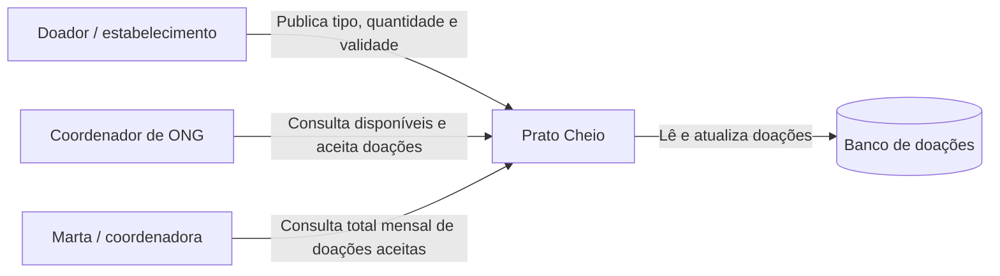

# Diagrama de contexto — Prato Cheio

O sistema aproxima estabelecimentos doadores de ONGs que recebem alimentos excedentes. No piloto, ambos acessam a aplicação pelo navegador; o backend valida as regras e consulta o banco de doações.

O sistema não implementa autenticação completa nem integração com sistemas externos neste incremento.
