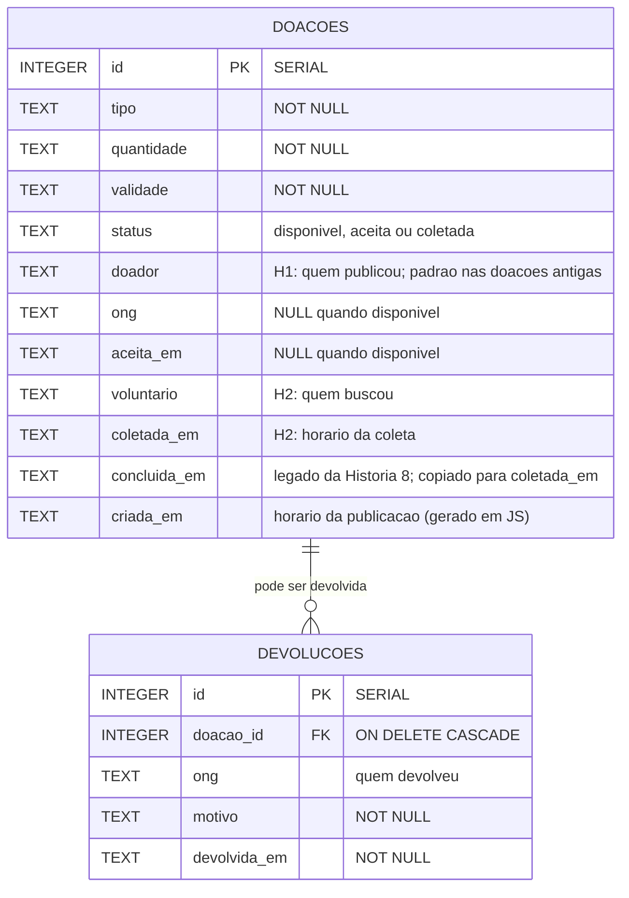
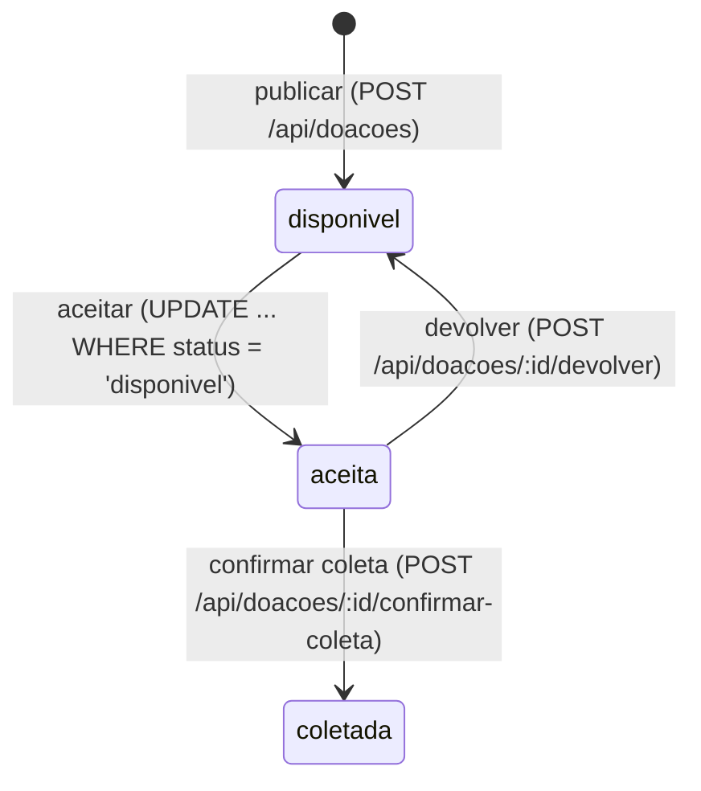

# Diagrama de dados — Prato Cheio
*Pergunta que este diagrama responde:* o que o banco guarda sobre cada doação e como cada
operação muda o estado do lote?
A versão original (Aula 7) está em `docs/aulas/Análise e Modelação de SistemaProjeto_
Prato Cheio.pdf`, seção 2. Este diagrama acompanha o schema que `migrar()` (`src/db.js`)
cria no PostgreSQL ao fim do Trabalho 3.
## Hoje (o que o `src/db.js` cria no PostgreSQL)

Transições de estado (decisão 4 de `docs/projeto.md`; no código, a tabela `TRANSICOES` em
`src/doacoes.js`):

Qualquer outra transição é recusada com HTTP 400 e a doação não muda. A devolução limpa
`ong` e `aceita_em` da doação e grava uma linha em `DEVOLUCOES`, na mesma instrução SQL.
Os horários são `TEXT` no formato `AAAA-MM-DD HH:MM:SS` (UTC), gerados em
`src/repositorio.js` para que os testes controlem o relógio (H4).
## Divergências declaradas
| # | Onde diverge | Diagrama ou documento | Código (`src/`) | O que fazemos |
|---|---|---|---|---|
| 1 | Nome do estado após o aceite | Análise (Regra 2): `RESERVADO` | `aceita` | Mantido
`aceita`; a correspondência está em `docs/validacao.md` → Mudanças de critério |
| 2 | Nome do estado final | Regra 3: `CONCLUIDO` | `coletada` (era `concluida` até a H2)
| `migrar()` converte as linhas antigas; `concluida_em` fica só como legado |
| 3 | Coluna de versão do lock otimista | Decisão de projeto #1 | não existe: o `UPDATE`
usa `WHERE status = ...` | A condição no estado já garante a exclusividade (teste de
concorrência do aceite) |
| 4 | Identidade de doador e ONG | Conflito 1: token/link mágico | `doador` e `ong` são
nomes digitados, sem autenticação | Limitação registrada em `docs/validacao.md` |
| 5 | Tipo das datas | Planejado: `TIMESTAMPTZ` | `TEXT` em UTC | A conversão segue
pendente; o relatório usa `::timestamp` no SQL |
