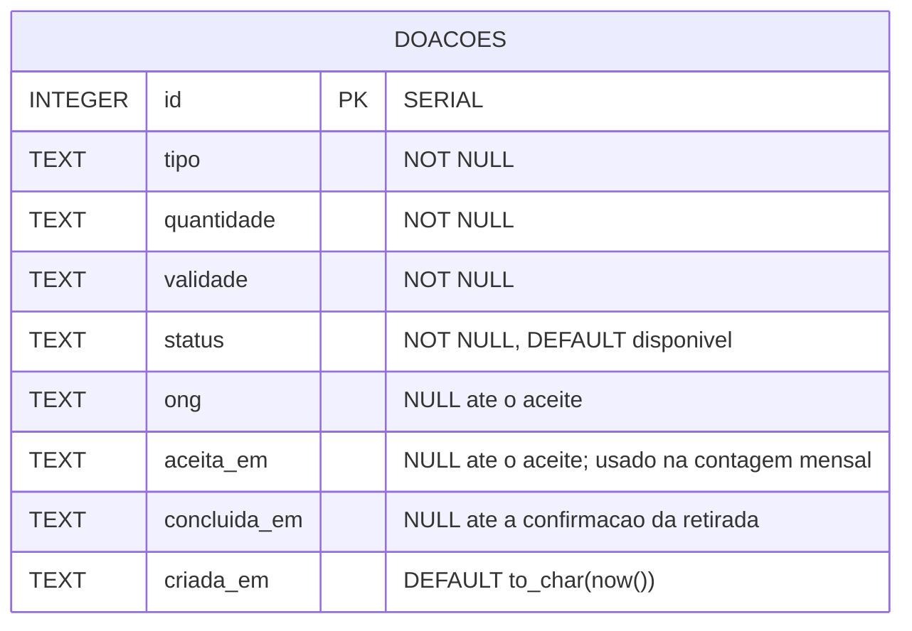
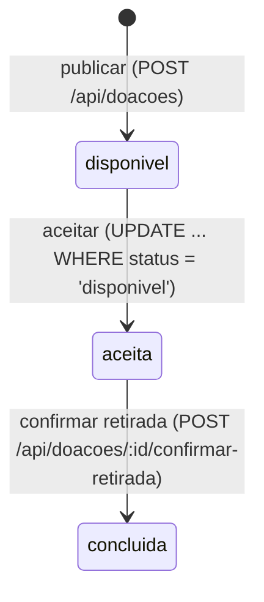
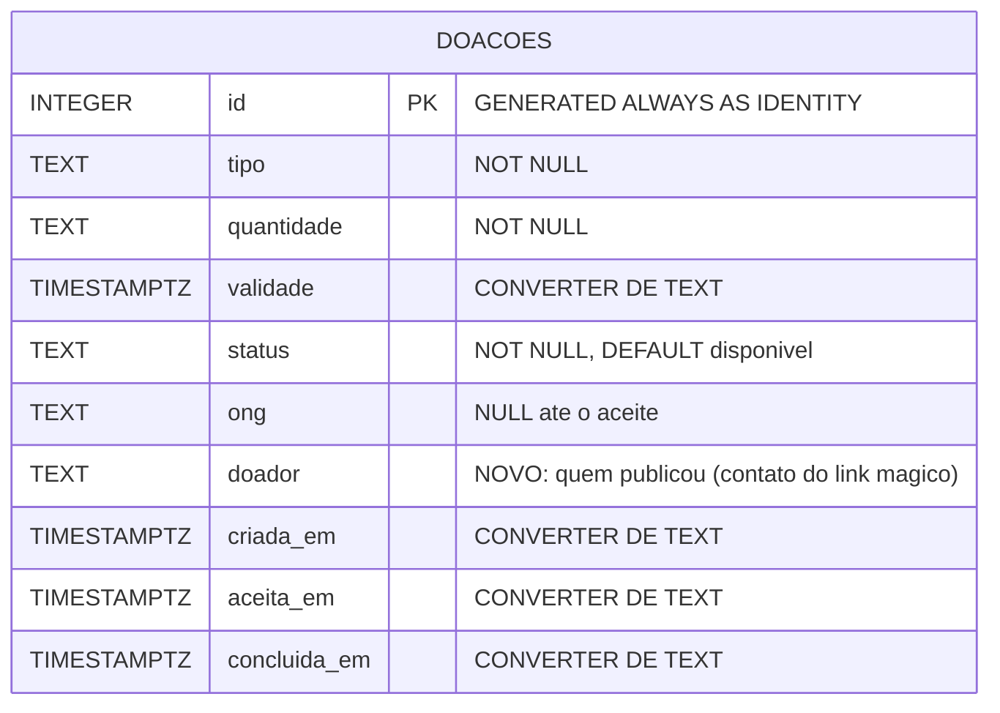

# Diagrama de dados — Prato Cheio

*Pergunta que este diagrama responde:* o que o banco guarda sobre cada doação e como o aceite muda o estado do lote?

A versão original (Aula 7) está em `docs/aulas/Análise e Modelação de SistemaProjeto_ Prato Cheio.pdf`, seção 2. Este diagrama acompanha o schema PostgreSQL atual e a confirmação manual da retirada.

## Hoje (o que o `src/db.js` cria no PostgreSQL)

Transição de estados, por `UPDATE` na própria linha (não existe tabela de aceites):

`GET /api/doacoes/pendencias?ong=...` lista somente as doações `aceita` da ONG informada. Após a confirmação, `concluida_em` registra o encerramento e a doação passa a aparecer em `GET /api/doacoes/historico?ong=...`.

## Evolução ainda não aplicada

`aceita_em` é usado pela rota `GET /api/relatorios/doacoes-aceitas?mes=AAAA-MM`; `concluida_em` registra a confirmação da retirada. Ambos são `TEXT` no schema atual. A coluna `doador` ainda não existe. Converter datas para `TIMESTAMPTZ` e decidir a identidade autenticada da ONG permanecem fora deste incremento.

## Divergências declaradas

| # | Onde diverge | Diagrama ou documento | Código (`src/`) | O que fazemos |
|---|---|---|---|---|
| 1 | Nome do estado após o aceite | Análise (Regra 2) e PDF da Aula 7: `RESERVADO` / `reservado` | `repositorio.js` grava `'aceita'`, e o teste espera `'aceita'` | Mantido `aceita` no código até a Unidade 3. Trocar exige mudar teste, então fica fora da refatoração do banco e entra como decisão própria |
| 2 | Nome do estado final | Regra 3 e PDF: `CONCLUIDO` | `repositorio.js` grava `concluida` e `concluida_em`; a retirada é restrita à ONG que aceitou | Mantido `concluida` conforme a Fatia 1 em `docs/analise.md`; a confirmação agora está implementada |
| 3 | Coluna de versão do lock otimista | Decisão de projeto #1: "coluna de versão no lote, `… AND version = X`" | não existe: o `UPDATE` usa só `WHERE status = 'disponivel'` | Para um único campo de estado, a condição no status já garante a exclusividade. A coluna de versão fica sem uso enquanto o lote não tiver outros campos editáveis |
| 4 | Quem publicou e quando houve aceite/retirada | Conflito 1 e Revisão do ADR 0001: precisa constar na cópia mensal | `aceita_em` e `concluida_em` são preenchidos nos respectivos fluxos; ainda não há `doador` | A identidade do doador segue fora do incremento |
| 5 | Tipo das datas | Planejado: `TIMESTAMPTZ` | `TEXT` no PostgreSQL atual | A conversão para `TIMESTAMPTZ` segue pendente |
